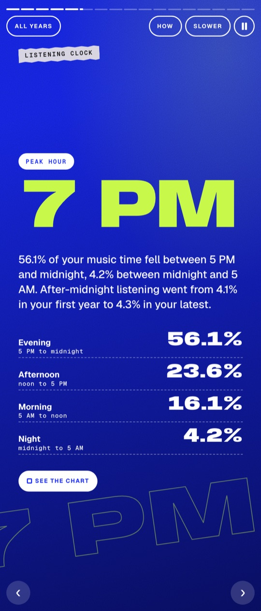
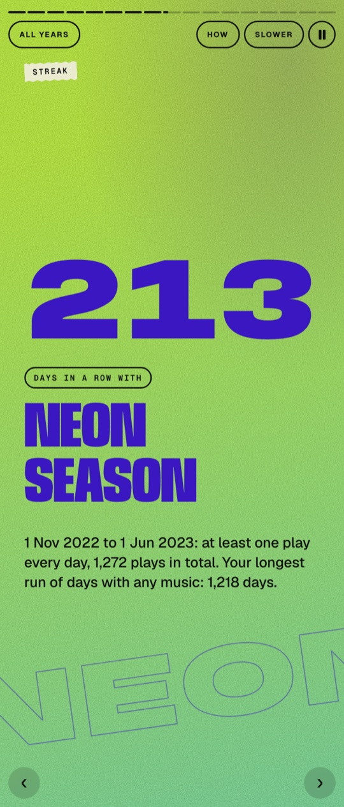
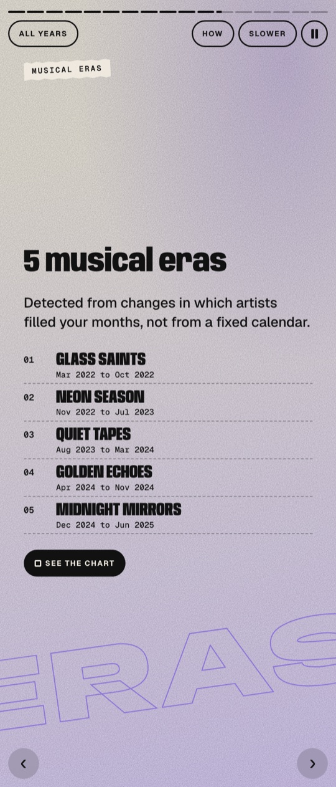

<h1 align="center">Spotify Rewind</h1>

<p align="center">
Turn a Spotify extended streaming history export into a Wrapped-style story, with musical eras found by
change-point detection and every number traced back to the data.
</p>

<p align="center">




</p>

<p align="center"><b><a href="https://savsuth.github.io/spotify-rewind/">Open the live demo</a></b><br>
<sub>Built entirely from a synthetic export with planted ground truth. No personal data.</sub></p>

## Table of Contents

- [About](#about)
- [Getting Started](#getting_started)
- [Running the tests](#tests)
- [Usage](#usage)
- [Deployment](#deployment)
- [Built Using](#built_using)
- [Authors](#authors)
- [Acknowledgements](#acknowledgement)

## About <a name = "about"></a>

Spotify's yearly Wrapped shows one year at a time and never explains its numbers. Spotify Rewind reads the
full extended streaming history you can request from Spotify and tells the multi-year story: which artists
entered your listening, became constants, faded, or came back, and when your taste actually shifted.

What it does:

- **Cleans and reconciles the export.** Every raw record lands in exactly one bucket (music, podcast,
  exact duplicate, invalid). Local time comes from each record's connection country, offline plays logged at
  sync time are kept out of timing stats, and account, IP and device fields are dropped before analysis.
- **Detects musical eras with PELT.** Each month becomes a vector of square-rooted artist shares over every
  artist in the export; PELT with a squared-error cost finds the boundaries. The penalty is calibrated on
  synthetic histories, each boundary is checked under block resampling of listening days, and boundaries that
  do not survive are reported as insufficient evidence instead of being shown.
- **Explains every boundary** by exact per-artist contributions (who rose, faded, persisted or returned), and
  tracks each artist's lifecycle: first seen, sustained favourite, peak, comeback after a gap.
- **Finds habits and obsessions:** listening clock with streams split across clock hours, biggest day,
  day streaks, the song you had on repeat, longest session.
- **Generates every headline from a template** filled with computed values; stories without evidence are
  omitted. A "How calculated" panel shows the method and evidence for each scene.
- **Presents it as a story player** in the direction of Wrapped 2025: oversized variable-width type, bold
  gradients with grain, a 9:16 card on phone and desktop, keyboard control, pause on hidden tab, reduced motion.
  Charts are drawn with the diagram-design skill and pass its validators.

### Does it find what is really there?

A synthetic export generator writes data in the real export's schema with known structure planted in it
(five eras, a comeback after a long silence, a biggest day, an evening peak, a week abroad in another
timezone, podcasts, duplicates, offline syncs). The full pipeline runs on it and an evaluator compares what it
recovered with the planted answers, which are computed by the generator independently of the analysis code.

| Check | Result on the demo export (seed 7) |
|---|---|
| Raw records, duplicates, podcasts, music records, minutes | exact match (39,277 / 40 / 801 / 38,436 / 87,270.3) |
| Era boundaries (4 planted, within one month) | precision 1.0, recall 1.0 |
| Comeback artist and return month | match |
| Biggest day, peak 3-hour window, top artist, longest streak | match |
| Travel-week records on the right timezone | 219 of 219 |
| Same 13 checks on seeds 1-5 | 13/13 each |

On the calibration histories generated for the demo export, PELT reaches a pooled boundary F1 of 1.00 against
0.94 for an adjacent-month-distance baseline, and 1.00 against 0.22 on gradual taste drift, where comparing
neighbouring months misses the change. Every reported boundary survives 100% of 200 day-block resamples, and
shuffling the month order produces no boundaries in 200 runs. Full table: [docs/evaluation.md](docs/evaluation.md).

<p align="center"></p>

Architecture: [docs/architecture.html](docs/architecture.html) (open in a browser).

## Getting Started <a name = "getting_started"></a>

### Prerequisites

- Python 3.11 or newer
- Node.js 18 or newer, only for the JavaScript tests

### Installing

```bash
git clone <this repository>
cd spotify-rewind
python3 -m venv .venv && source .venv/bin/activate
pip install .
```

This installs the `rewind` command (also available as `python3 -m rewind` from a checkout), with pandas and
NumPy as the only dependencies.

Try it without any personal data:

```bash
rewind demo --out dist/demo
python3 -m http.server 8766 --directory dist/demo/site
```

Open http://localhost:8766. The demo writes a synthetic export, builds the story and prints the ground-truth
score; `dist/demo/outputs/` holds the evaluation, methodology and audit reports.

## Running the tests <a name = "tests"></a>

```bash
python3 -m unittest discover -s tests -v
node --test tests/js/*.test.mjs
```

### Break down into end to end tests

`tests/test_synth_e2e.py` generates a synthetic export, runs the command line end to end and requires every
planted answer to be recovered. It also checks the generated files against the real export schema and that a
timezone override shifts local times correctly (including daylight-saving edges).

### And unit tests

- PELT against an exact O(n^2) optimal-partitioning search on 300 random histories
- cleaning edge cases: exact vs offline-batch duplicates, invalid records, timezone and filename-year handling,
  the 30-second play threshold, privacy stripping
- habits: hour splitting across boundaries and midnight, streak runs, Monday-to-Sunday weeks, session gaps
- frontend: playback state machine on a fake clock (one timer at most, stale timers ignored, quiz waits for an
  answer, pause on hidden tab), palette contrast on both gradient ends, the quiz never showing its answer early

Tests that need a personal export skip with a stated reason when it is absent.

## Usage <a name="usage"></a>

Request "Extended streaming history" from Spotify's privacy page, unzip it, then:

```bash
rewind build --export "path/to/Spotify Extended Streaming History" --out dist/me
python3 -m http.server 8765 --directory dist/me/site
```

Options:

- `--tz US=America/Chicago` sets the zone for a country that spans several (repeatable)
- `--techlog "path/to/Spotify Technical Log Information"` adds a cross-check of log stream events against the history
- `--quick` runs fewer validation resamples, for a fast first look

In the player: Left/Right or tap to move, Space to pause, I for How calculated, "See the chart" for a scene's
chart, the chapter button for single years. Partial first and last years are labelled.

`rewind synth --out DIR --seed N` writes only a synthetic export and its `ground_truth.json`.

## Deployment <a name = "deployment"></a>

The site is static. Serve `dist/demo/site` (or your own `dist/<name>/site`) from any static host. Your own
build contains your listening history; publishing it is your decision. The `.gitignore` keeps exports and
everything derived from them (`work/`, `outputs/`, `web/data/`, `dist/`) out of the repository.

## Built Using <a name = "built_using"></a>

- Python, pandas, NumPy: cleaning, metrics, an in-house PELT implementation, bootstrap and synthetic validation
- Vanilla JavaScript ES modules and CSS container queries: the story player, no build step
- SVG charts from the diagram-design skill, including its polar chart for the listening clock
- Anybody, Geist and Instrument Serif from Google Fonts

## Authors <a name = "authors"></a>

- Aasav Suthar ([savsuth](https://github.com/savsuth))

## Acknowledgements <a name = "acknowledgement"></a>

- Killick, Fearnhead and Eckley (2012), "Optimal detection of changepoints with a linear computational cost" (PELT)
- Spotify Wrapped, for the story format this project borrows. This is a personal project and is not affiliated
  with Spotify.
- The Documentation Compendium, for this README's structure.
